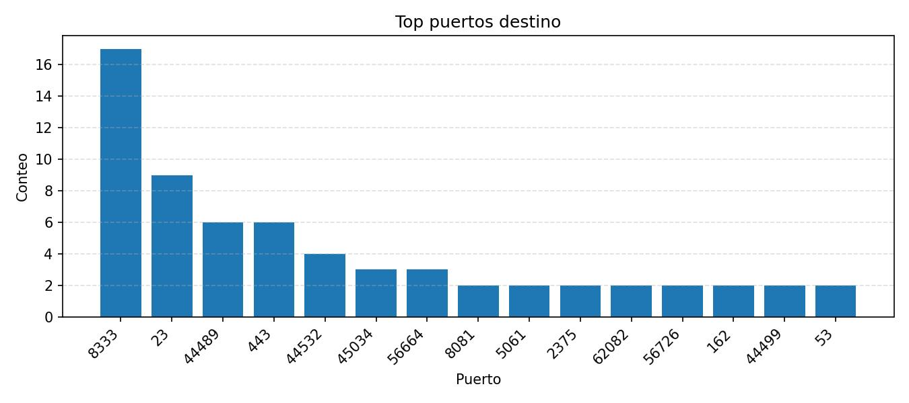
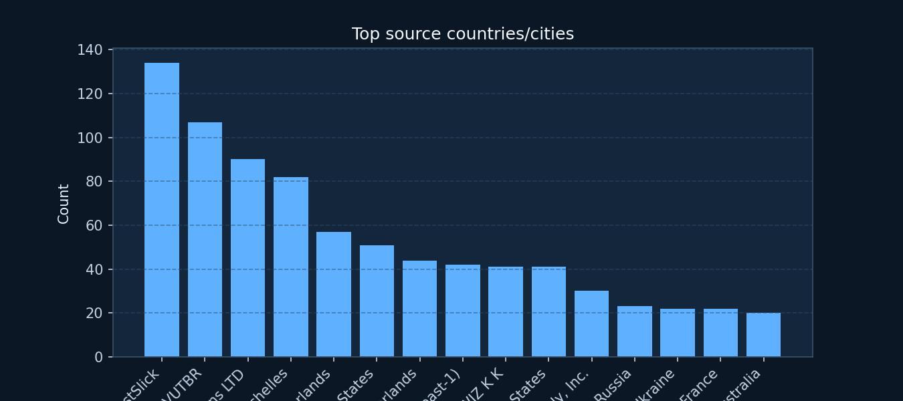
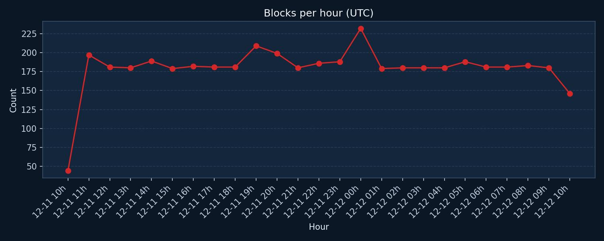
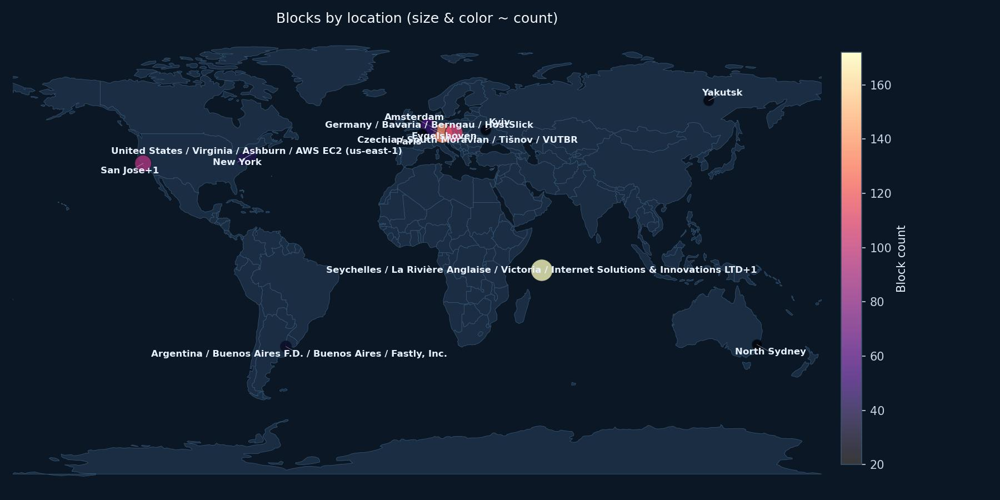

# UFW Block Report

- Log: `/var/log/ufw.log`
- Window: last 24.0 hours
- Total blocks: 4404
- Unique source IPs: 2533
- Unique countries/cities (24h): 277
- Unique destination ports: 2590

## Top destination ports
| # | Destination port | Count | % |
| ---: | --- | ---: | ---: |
| 1 | `23` | 108 | 2.5% |
| 2 | `22` | 67 | 1.5% |
| 3 | `5060` | 62 | 1.4% |
| 4 | `53` | 43 | 1.0% |
| 5 | `8080` | 43 | 1.0% |
| 6 | `1433` | 39 | 0.9% |
| 7 | `3389` | 31 | 0.7% |
| 8 | `8443` | 25 | 0.6% |
| 9 | `3306` | 24 | 0.5% |
| 10 | `161` | 22 | 0.5% |
| 11 | `8081` | 19 | 0.4% |
| 12 | `3128` | 17 | 0.4% |
| 13 | `21` | 17 | 0.4% |
| 14 | `1723` | 16 | 0.4% |
| 15 | `123` | 15 | 0.3% |

## Top protocols
| # | Protocol | Count | % |
| ---: | --- | ---: | ---: |
| 1 | `TCP` | 4030 | 91.5% |
| 2 | `UDP` | 373 | 8.5% |
| 3 | `47` | 1 | 0.0% |

## Top source IPs
| # | Source IP | Count | % |
| ---: | --- | ---: | ---: |
| 1 | `103.122.221.179` | 57 | 1.3% |
| 2 | `151.101.218.13` | 29 | 0.7% |
| 3 | `18.221.179.104` | 16 | 0.4% |
| 4 | `91.231.89.117` | 16 | 0.4% |
| 5 | `34.197.70.90` | 15 | 0.3% |
| 6 | `141.98.83.48` | 15 | 0.3% |
| 7 | `79.120.72.180` | 15 | 0.3% |
| 8 | `91.230.168.190` | 14 | 0.3% |
| 9 | `91.231.89.205` | 14 | 0.3% |
| 10 | `91.231.89.10` | 13 | 0.3% |
| 11 | `45.198.224.125` | 13 | 0.3% |
| 12 | `195.184.76.198` | 12 | 0.3% |
| 13 | `195.184.76.220` | 12 | 0.3% |
| 14 | `91.231.89.0` | 12 | 0.3% |
| 15 | `18.190.15.50` | 12 | 0.3% |

## Top TCP flag patterns
| # | Flags | Count | % |
| ---: | --- | ---: | ---: |
| 1 | `SYN` | 3907 | 96.9% |
| 2 | `ACK+FIN+PSH` | 72 | 1.8% |
| 3 | `ACK+PSH` | 31 | 0.8% |
| 4 | `ACK+FIN` | 11 | 0.3% |
| 5 | `ACK` | 7 | 0.2% |
| 6 | `SYN+ECE+CWR` | 1 | 0.0% |
| 7 | `RST` | 1 | 0.0% |

## Top inbound interfaces (IN)
| # | Interface | Count | % |
| ---: | --- | ---: | ---: |
| 1 | `eth0` | 4404 | 100.0% |

## Top source IP -> destination port
| # | Source IP -> port | Count | % |
| ---: | --- | ---: | ---: |
| 1 | `172.110.223.188` -> `5060` | 10 | 0.2% |
| 2 | `172.110.223.182` -> `5060` | 10 | 0.2% |
| 3 | `62.210.114.99` -> `3389` | 8 | 0.2% |
| 4 | `151.101.218.13` -> `11729` | 8 | 0.2% |
| 5 | `52.88.236.22` -> `16757` | 7 | 0.2% |
| 6 | `178.20.210.152` -> `1723` | 7 | 0.2% |
| 7 | `66.132.159.74` -> `53` | 7 | 0.2% |
| 8 | `23.212.49.19` -> `62060` | 7 | 0.2% |
| 9 | `169.150.214.167` -> `64272` | 7 | 0.2% |
| 10 | `45.198.224.125` -> `9090` | 6 | 0.1% |
| 11 | `154.80.128.160` -> `6036` | 6 | 0.1% |
| 12 | `186.123.1.125` -> `1433` | 6 | 0.1% |
| 13 | `45.198.224.125` -> `8081` | 6 | 0.1% |
| 14 | `91.224.92.45` -> `34568` | 6 | 0.1% |
| 15 | `154.80.128.163` -> `17000` | 5 | 0.1% |

## Blocks per hour (UTC)
| Hour (UTC) | Count | % |
| :--- | ---: | ---: |
| 2026-11-02 04:00:00:00 | 134 | 3.0% |
| 2026-11-02 05:00:00:00 | 180 | 4.1% |
| 2026-11-02 06:00:00:00 | 180 | 4.1% |
| 2026-11-02 07:00:00:00 | 180 | 4.1% |
| 2026-11-02 08:00:00:00 | 179 | 4.1% |
| 2026-11-02 09:00:00:00 | 181 | 4.1% |
| 2026-11-02 10:00:00:00 | 180 | 4.1% |
| 2026-11-02 11:00:00:00 | 180 | 4.1% |
| 2026-11-02 12:00:00:00 | 180 | 4.1% |
| 2026-11-02 13:00:00:00 | 179 | 4.1% |
| 2026-11-02 14:00:00:00 | 180 | 4.1% |
| 2026-11-02 15:00:00:00 | 181 | 4.1% |
| 2026-11-02 16:00:00:00 | 180 | 4.1% |
| 2026-11-02 17:00:00:00 | 177 | 4.0% |
| 2026-11-02 18:00:00:00 | 183 | 4.2% |
| 2026-11-02 19:00:00:00 | 180 | 4.1% |
| 2026-11-02 20:00:00:00 | 179 | 4.1% |
| 2026-11-02 21:00:00:00 | 180 | 4.1% |
| 2026-11-02 22:00:00:00 | 181 | 4.1% |
| 2026-11-02 23:00:00:00 | 198 | 4.5% |
| 2026-11-03 00:00:00:00 | 196 | 4.5% |
| 2026-11-03 01:00:00:00 | 202 | 4.6% |
| 2026-11-03 02:00:00:00 | 194 | 4.4% |
| 2026-11-03 03:00:00:00 | 192 | 4.4% |
| 2026-11-03 04:00:00:00 | 47 | 1.1% |

## Top source countries/cities
| # | Location | Count | % |
| ---: | --- | ---: | ---: |
| 1 | Da Nang, Vietnam | 57 | 21.5% |
| 2 | Gravelines, France | 55 | 20.8% |
| 3 | Buenos Aires, Argentina | 29 | 10.9% |
| 4 | Dublin, United States | 28 | 10.6% |
| 5 | Warrenton, United States | 24 | 9.1% |
| 6 | Ashburn, United States | 15 | 5.7% |
| 7 | Panama City, Panama | 15 | 5.7% |
| 8 | Klin, Russia | 15 | 5.7% |
| 9 | Hillsboro, United States | 14 | 5.3% |
| 10 | Stockholm, Sweden | 13 | 4.9% |

## Geolocation (max 15 IPs)
| # | Source IP | Count | % | Location | Network / hint |
| ---: | --- | ---: | ---: | --- | --- |
| 1 | `103.122.221.179` | 57 | 21.5% | Vietnam / Da Nang City / Da Nang / HA SON Technology ONE Member Limited Company | No apparent signal |
| 2 | `151.101.218.13` | 29 | 10.9% | Argentina / Buenos Aires F.D. / Buenos Aires / Fastly, Inc. | CDN/Edge (fastly) |
| 3 | `18.221.179.104` | 16 | 6.0% | United States / Ohio / Dublin / AWS EC2 (us-east-2) | Hosting/Cloud (aws) |
| 4 | `91.231.89.117` | 16 | 6.0% | France / Hauts-de-France / Gravelines / ONYPHE | No apparent signal |
| 5 | `34.197.70.90` | 15 | 5.7% | United States / Virginia / Ashburn / AWS EC2 (us-east-1) | Hosting/Cloud (aws) |
| 6 | `141.98.83.48` | 15 | 5.7% | Panama / Provincia de Panamá / Panama City / GLOBALHOST | Hosting/Cloud (servers) |
| 7 | `79.120.72.180` | 15 | 5.7% | Russia / Moscow Oblast / Klin / Net By Net Holding LLC | No apparent signal |
| 8 | `91.230.168.190` | 14 | 5.3% | United States / Oregon / Hillsboro / ONYPHE | No apparent signal |
| 9 | `91.231.89.205` | 14 | 5.3% | France / Hauts-de-France / Gravelines / ONYPHE | No apparent signal |
| 10 | `91.231.89.10` | 13 | 4.9% | France / Hauts-de-France / Gravelines / ONYPHE | No apparent signal |
| 11 | `45.198.224.125` | 13 | 4.9% | Sweden / Stockholm County / Stockholm / Vpsvault.host LTD | No apparent signal |
| 12 | `195.184.76.198` | 12 | 4.5% | United States / Virginia / Warrenton / ONYPHE | No apparent signal |
| 13 | `195.184.76.220` | 12 | 4.5% | United States / Virginia / Warrenton / ONYPHE | No apparent signal |
| 14 | `91.231.89.0` | 12 | 4.5% | France / Hauts-de-France / Gravelines / ONYPHE | No apparent signal |
| 15 | `18.190.15.50` | 12 | 4.5% | United States / Ohio / Dublin / AWS EC2 (us-east-2) | Hosting/Cloud (aws) |

## VPN/Proxy/Hosting suspicion (heuristic)
| # | Source IP | Count | % | Suspicion | Location |
| ---: | --- | ---: | ---: | --- | --- |
| 1 | `151.101.218.13` | 29 | 33.3% | CDN/Edge (fastly) | Argentina / Buenos Aires F.D. / Buenos Aires / Fastly, Inc. |
| 2 | `18.221.179.104` | 16 | 18.4% | Hosting/Cloud (aws) | United States / Ohio / Dublin / AWS EC2 (us-east-2) |
| 3 | `34.197.70.90` | 15 | 17.2% | Hosting/Cloud (aws) | United States / Virginia / Ashburn / AWS EC2 (us-east-1) |
| 4 | `141.98.83.48` | 15 | 17.2% | Hosting/Cloud (servers) | Panama / Provincia de Panamá / Panama City / GLOBALHOST |
| 5 | `18.190.15.50` | 12 | 13.8% | Hosting/Cloud (aws) | United States / Ohio / Dublin / AWS EC2 (us-east-2) |

## Charts

