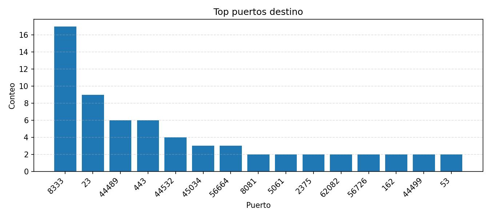
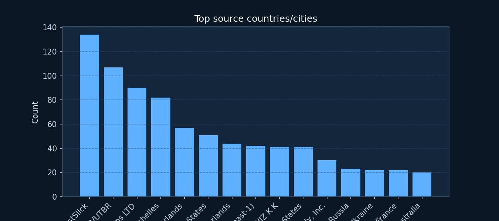
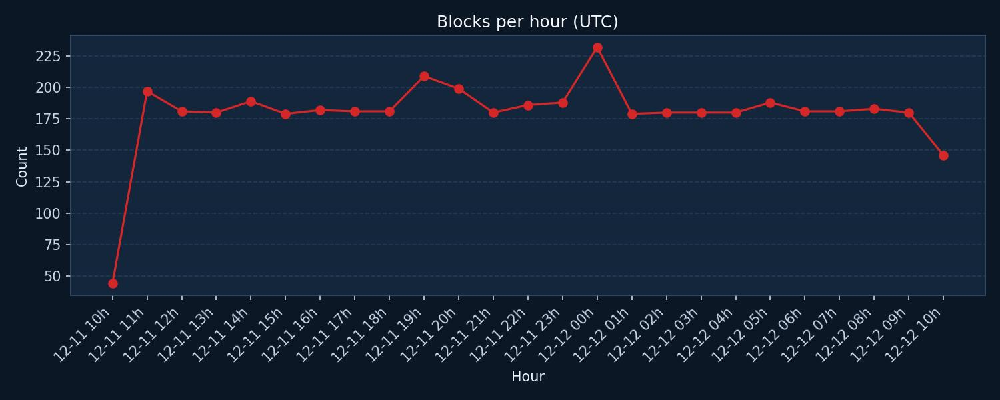
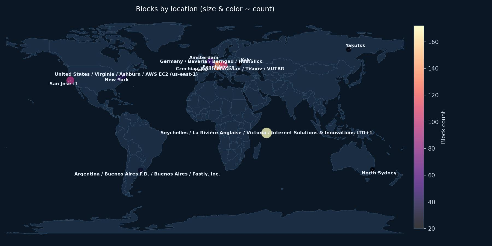

# UFW Block Report

- Log: `/var/log/ufw.log`
- Window: last 24.0 hours
- Total blocks: 4527
- Unique source IPs: 2280
- Unique countries/cities (24h): 279
- Unique destination ports: 2570

## Top destination ports
| # | Destination port | Count | % |
| ---: | --- | ---: | ---: |
| 1 | `23` | 180 | 4.0% |
| 2 | `22` | 65 | 1.4% |
| 3 | `8080` | 43 | 0.9% |
| 4 | `3389` | 33 | 0.7% |
| 5 | `5060` | 32 | 0.7% |
| 6 | `53` | 29 | 0.6% |
| 7 | `8443` | 27 | 0.6% |
| 8 | `1723` | 23 | 0.5% |
| 9 | `5432` | 20 | 0.4% |
| 10 | `3306` | 19 | 0.4% |
| 11 | `8081` | 19 | 0.4% |
| 12 | `8888` | 19 | 0.4% |
| 13 | `161` | 17 | 0.4% |
| 14 | `1433` | 17 | 0.4% |
| 15 | `2222` | 16 | 0.4% |

## Top protocols
| # | Protocol | Count | % |
| ---: | --- | ---: | ---: |
| 1 | `TCP` | 4146 | 91.6% |
| 2 | `UDP` | 380 | 8.4% |
| 3 | `47` | 1 | 0.0% |

## Top source IPs
| # | Source IP | Count | % |
| ---: | --- | ---: | ---: |
| 1 | `216.180.246.172` | 91 | 2.0% |
| 2 | `151.101.218.13` | 74 | 1.6% |
| 3 | `160.119.76.27` | 63 | 1.4% |
| 4 | `194.44.33.47` | 28 | 0.6% |
| 5 | `38.103.158.153` | 25 | 0.6% |
| 6 | `85.217.140.22` | 18 | 0.4% |
| 7 | `2.22.149.176` | 18 | 0.4% |
| 8 | `85.217.140.2` | 16 | 0.4% |
| 9 | `2.22.149.152` | 16 | 0.4% |
| 10 | `91.230.168.129` | 15 | 0.3% |
| 11 | `85.217.140.28` | 15 | 0.3% |
| 12 | `85.217.140.6` | 15 | 0.3% |
| 13 | `85.217.149.37` | 15 | 0.3% |
| 14 | `79.124.40.162` | 14 | 0.3% |
| 15 | `91.231.89.150` | 14 | 0.3% |

## Top TCP flag patterns
| # | Flags | Count | % |
| ---: | --- | ---: | ---: |
| 1 | `SYN` | 3865 | 93.2% |
| 2 | `ACK+FIN+PSH` | 181 | 4.4% |
| 3 | `ACK+PSH` | 58 | 1.4% |
| 4 | `ACK+FIN` | 30 | 0.7% |
| 5 | `SYN+ECE+CWR` | 11 | 0.3% |
| 6 | `ACK` | 1 | 0.0% |

## Top inbound interfaces (IN)
| # | Interface | Count | % |
| ---: | --- | ---: | ---: |
| 1 | `eth0` | 4527 | 100.0% |

## Top source IP -> destination port
| # | Source IP -> port | Count | % |
| ---: | --- | ---: | ---: |
| 1 | `194.44.33.47` -> `23` | 28 | 0.6% |
| 2 | `34.187.120.60` -> `5432` | 12 | 0.3% |
| 3 | `93.123.109.6` -> `1723` | 8 | 0.2% |
| 4 | `45.205.1.160` -> `6036` | 8 | 0.2% |
| 5 | `151.101.218.13` -> `8261` | 8 | 0.2% |
| 6 | `216.180.246.172` -> `17007` | 8 | 0.2% |
| 7 | `45.198.224.124` -> `81` | 7 | 0.2% |
| 8 | `151.101.218.13` -> `7801` | 7 | 0.2% |
| 9 | `2.22.149.171` -> `8053` | 7 | 0.2% |
| 10 | `170.51.247.49` -> `53958` | 7 | 0.2% |
| 11 | `216.180.246.172` -> `16993` | 7 | 0.2% |
| 12 | `216.180.246.172` -> `16995` | 7 | 0.2% |
| 13 | `170.51.241.179` -> `53302` | 7 | 0.2% |
| 14 | `216.180.246.172` -> `18080` | 7 | 0.2% |
| 15 | `149.200.5.244` -> `23` | 6 | 0.1% |

## Blocks per hour (UTC)
| Hour (UTC) | Count | % |
| :--- | ---: | ---: |
| 2026-10-14 04:00:00:00 | 135 | 3.0% |
| 2026-10-14 05:00:00:00 | 202 | 4.5% |
| 2026-10-14 06:00:00:00 | 179 | 4.0% |
| 2026-10-14 07:00:00:00 | 181 | 4.0% |
| 2026-10-14 08:00:00:00 | 180 | 4.0% |
| 2026-10-14 09:00:00:00 | 180 | 4.0% |
| 2026-10-14 10:00:00:00 | 180 | 4.0% |
| 2026-10-14 11:00:00:00 | 200 | 4.4% |
| 2026-10-14 12:00:00:00 | 177 | 3.9% |
| 2026-10-14 13:00:00:00 | 189 | 4.2% |
| 2026-10-14 14:00:00:00 | 181 | 4.0% |
| 2026-10-14 15:00:00:00 | 200 | 4.4% |
| 2026-10-14 16:00:00:00 | 187 | 4.1% |
| 2026-10-14 17:00:00:00 | 207 | 4.6% |
| 2026-10-14 18:00:00:00 | 216 | 4.8% |
| 2026-10-14 19:00:00:00 | 179 | 4.0% |
| 2026-10-14 20:00:00:00 | 183 | 4.0% |
| 2026-10-14 21:00:00:00 | 181 | 4.0% |
| 2026-10-14 22:00:00:00 | 195 | 4.3% |
| 2026-10-14 23:00:00:00 | 193 | 4.3% |
| 2026-10-15 00:00:00:00 | 182 | 4.0% |
| 2026-10-15 01:00:00:00 | 204 | 4.5% |
| 2026-10-15 02:00:00:00 | 196 | 4.3% |
| 2026-10-15 03:00:00:00 | 180 | 4.0% |
| 2026-10-15 04:00:00:00 | 40 | 0.9% |

## Top source countries/cities
| # | Location | Count | % |
| ---: | --- | ---: | ---: |
| 1 | Buenos Aires, Argentina | 108 | 24.7% |
| 2 | Massy, France | 91 | 20.8% |
| 3 | Gravelines, France | 78 | 17.8% |
| 4 | Amsterdam, The Netherlands | 63 | 14.4% |
| 5 | Lviv, Ukraine | 28 | 6.4% |
| 6 | Saint-Laurent, Canada | 25 | 5.7% |
| 7 | Hillsboro, United States | 15 | 3.4% |
| 8 | Beauharnois, Canada | 15 | 3.4% |
| 9 | Sopot, Bulgaria | 14 | 3.2% |

## Geolocation (max 15 IPs)
| # | Source IP | Count | % | Location | Network / hint |
| ---: | --- | ---: | ---: | --- | --- |
| 1 | `216.180.246.172` | 91 | 20.8% | France / Île-de-France / Massy / Google LLC | Hosting/Cloud (google llc) |
| 2 | `151.101.218.13` | 74 | 16.9% | Argentina / Buenos Aires F.D. / Buenos Aires / Fastly, Inc. | CDN/Edge (fastly) |
| 3 | `160.119.76.27` | 63 | 14.4% | The Netherlands / North Holland / Amsterdam / HostUS Solutions LLC | No apparent signal |
| 4 | `194.44.33.47` | 28 | 6.4% | Ukraine / Lviv / Lviv / TzOV "Biznes i Technologii" | No apparent signal |
| 5 | `38.103.158.153` | 25 | 5.7% | Canada / Quebec / Saint-Laurent / Cogent Communications | No apparent signal |
| 6 | `85.217.140.22` | 18 | 4.1% | France / Hauts-de-France / Gravelines / Modat B.V | No apparent signal |
| 7 | `2.22.149.176` | 18 | 4.1% | Argentina / Buenos Aires F.D. / Buenos Aires / Akamai Technologies | CDN/Edge (akamai) |
| 8 | `85.217.140.2` | 16 | 3.7% | France / Hauts-de-France / Gravelines / Modat B.V | No apparent signal |
| 9 | `2.22.149.152` | 16 | 3.7% | Argentina / Buenos Aires F.D. / Buenos Aires / Akamai Technologies | CDN/Edge (akamai) |
| 10 | `91.230.168.129` | 15 | 3.4% | United States / Oregon / Hillsboro / ONYPHE | No apparent signal |
| 11 | `85.217.140.28` | 15 | 3.4% | France / Hauts-de-France / Gravelines / Modat B.V | No apparent signal |
| 12 | `85.217.140.6` | 15 | 3.4% | France / Hauts-de-France / Gravelines / Modat B.V | No apparent signal |
| 13 | `85.217.149.37` | 15 | 3.4% | Canada / Quebec / Beauharnois / Modat B.V | No apparent signal |
| 14 | `79.124.40.162` | 14 | 3.2% | Bulgaria / Plovdiv / Sopot / Tamatiya EOOD | No apparent signal |
| 15 | `91.231.89.150` | 14 | 3.2% | France / Hauts-de-France / Gravelines / ONYPHE | No apparent signal |

## VPN/Proxy/Hosting suspicion (heuristic)
| # | Source IP | Count | % | Suspicion | Location |
| ---: | --- | ---: | ---: | --- | --- |
| 1 | `216.180.246.172` | 91 | 45.7% | Hosting/Cloud (google llc) | France / Île-de-France / Massy / Google LLC |
| 2 | `151.101.218.13` | 74 | 37.2% | CDN/Edge (fastly) | Argentina / Buenos Aires F.D. / Buenos Aires / Fastly, Inc. |
| 3 | `2.22.149.176` | 18 | 9.0% | CDN/Edge (akamai) | Argentina / Buenos Aires F.D. / Buenos Aires / Akamai Technologies |
| 4 | `2.22.149.152` | 16 | 8.0% | CDN/Edge (akamai) | Argentina / Buenos Aires F.D. / Buenos Aires / Akamai Technologies |

## Charts

