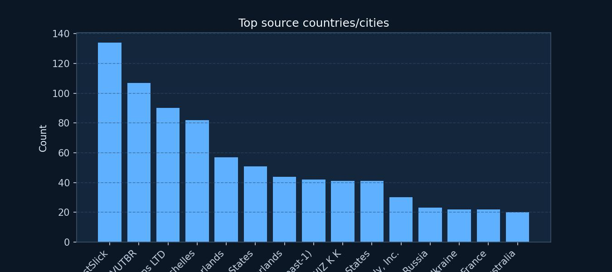

# UFW Block Report

- Log: `/var/log/ufw.log`
- Window: last 24.0 hours
- Total blocks: 4421
- Unique source IPs: 2446
- Unique countries/cities (24h): 291
- Unique destination ports: 2485

## Top destination ports
| # | Destination port | Count | % |
| ---: | --- | ---: | ---: |
| 1 | `23` | 103 | 2.3% |
| 2 | `22` | 62 | 1.4% |
| 3 | `3389` | 45 | 1.0% |
| 4 | `5060` | 36 | 0.8% |
| 5 | `8080` | 36 | 0.8% |
| 6 | `1433` | 31 | 0.7% |
| 7 | `53` | 29 | 0.7% |
| 8 | `5432` | 23 | 0.5% |
| 9 | `8443` | 21 | 0.5% |
| 10 | `3306` | 21 | 0.5% |
| 11 | `8888` | 20 | 0.5% |
| 12 | `2222` | 18 | 0.4% |
| 13 | `8000` | 17 | 0.4% |
| 14 | `161` | 17 | 0.4% |
| 15 | `8081` | 17 | 0.4% |

## Top protocols
| # | Protocol | Count | % |
| ---: | --- | ---: | ---: |
| 1 | `TCP` | 4024 | 91.0% |
| 2 | `UDP` | 387 | 8.8% |
| 3 | `132` | 6 | 0.1% |
| 4 | `47` | 4 | 0.1% |

## Top source IPs
| # | Source IP | Count | % |
| ---: | --- | ---: | ---: |
| 1 | `93.123.109.219` | 161 | 3.6% |
| 2 | `62.210.142.161` | 97 | 2.2% |
| 3 | `45.198.224.125` | 17 | 0.4% |
| 4 | `100.28.153.226` | 13 | 0.3% |
| 5 | `2.22.149.138` | 13 | 0.3% |
| 6 | `18.217.208.51` | 12 | 0.3% |
| 7 | `2.22.149.161` | 12 | 0.3% |
| 8 | `91.231.89.72` | 11 | 0.2% |
| 9 | `18.221.179.104` | 11 | 0.2% |
| 10 | `34.193.119.44` | 11 | 0.2% |
| 11 | `91.230.168.142` | 11 | 0.2% |
| 12 | `18.119.209.50` | 11 | 0.2% |
| 13 | `91.231.89.130` | 11 | 0.2% |
| 14 | `170.51.241.186` | 11 | 0.2% |
| 15 | `100.50.17.159` | 10 | 0.2% |

## Top TCP flag patterns
| # | Flags | Count | % |
| ---: | --- | ---: | ---: |
| 1 | `SYN` | 3882 | 96.5% |
| 2 | `ACK+FIN+PSH` | 83 | 2.1% |
| 3 | `ACK+PSH` | 38 | 0.9% |
| 4 | `ACK+FIN` | 15 | 0.4% |
| 5 | `SYN+ECE+CWR` | 4 | 0.1% |
| 6 | `ACK` | 2 | 0.0% |

## Top inbound interfaces (IN)
| # | Interface | Count | % |
| ---: | --- | ---: | ---: |
| 1 | `eth0` | 4421 | 100.0% |

## Top source IP -> destination port
| # | Source IP -> port | Count | % |
| ---: | --- | ---: | ---: |
| 1 | `8.219.165.42` -> `23` | 8 | 0.2% |
| 2 | `62.210.142.161` -> `10003` | 8 | 0.2% |
| 3 | `62.210.142.161` -> `11000` | 8 | 0.2% |
| 4 | `62.210.142.161` -> `10250` | 7 | 0.2% |
| 5 | `62.210.142.161` -> `10398` | 7 | 0.2% |
| 6 | `118.212.132.226` -> `22` | 6 | 0.1% |
| 7 | `95.100.88.81` -> `40105` | 6 | 0.1% |
| 8 | `31.70.89.138` -> `11434` | 6 | 0.1% |
| 9 | `62.210.142.161` -> `9999` | 6 | 0.1% |
| 10 | `62.210.142.161` -> `10001` | 6 | 0.1% |
| 11 | `62.210.142.161` -> `10002` | 6 | 0.1% |
| 12 | `170.51.241.186` -> `49889` | 6 | 0.1% |
| 13 | `62.210.142.161` -> `10023` | 6 | 0.1% |
| 14 | `45.198.224.125` -> `8081` | 5 | 0.1% |
| 15 | `45.198.224.125` -> `8080` | 5 | 0.1% |

## Blocks per hour (UTC)
| Hour (UTC) | Count | % |
| :--- | ---: | ---: |
| 2026-11-23 04:00:00:00 | 136 | 3.1% |
| 2026-11-23 05:00:00:00 | 179 | 4.0% |
| 2026-11-23 06:00:00:00 | 181 | 4.1% |
| 2026-11-23 07:00:00:00 | 180 | 4.1% |
| 2026-11-23 08:00:00:00 | 180 | 4.1% |
| 2026-11-23 09:00:00:00 | 180 | 4.1% |
| 2026-11-23 10:00:00:00 | 180 | 4.1% |
| 2026-11-23 11:00:00:00 | 191 | 4.3% |
| 2026-11-23 12:00:00:00 | 181 | 4.1% |
| 2026-11-23 13:00:00:00 | 179 | 4.0% |
| 2026-11-23 14:00:00:00 | 183 | 4.1% |
| 2026-11-23 15:00:00:00 | 197 | 4.5% |
| 2026-11-23 16:00:00:00 | 182 | 4.1% |
| 2026-11-23 17:00:00:00 | 195 | 4.4% |
| 2026-11-23 18:00:00:00 | 180 | 4.1% |
| 2026-11-23 19:00:00:00 | 181 | 4.1% |
| 2026-11-23 20:00:00:00 | 180 | 4.1% |
| 2026-11-23 21:00:00:00 | 189 | 4.3% |
| 2026-11-23 22:00:00:00 | 181 | 4.1% |
| 2026-11-23 23:00:00:00 | 194 | 4.4% |
| 2026-11-24 00:00:00:00 | 205 | 4.6% |
| 2026-11-24 01:00:00:00 | 181 | 4.1% |
| 2026-11-24 02:00:00:00 | 180 | 4.1% |
| 2026-11-24 03:00:00:00 | 179 | 4.0% |
| 2026-11-24 04:00:00:00 | 47 | 1.1% |

## Top source countries/cities
| # | Location | Count | % |
| ---: | --- | ---: | ---: |
| 1 | Andorra la Vella, Andorra | 161 | 39.1% |
| 2 | Paris, France | 97 | 23.5% |
| 3 | Buenos Aires, Argentina | 36 | 8.7% |
| 4 | Ashburn, United States | 34 | 8.3% |
| 5 | Dublin, United States | 34 | 8.3% |
| 6 | Gravelines, France | 22 | 5.3% |
| 7 | Stockholm, Sweden | 17 | 4.1% |
| 8 | Hillsboro, United States | 11 | 2.7% |

## Geolocation (max 15 IPs)
| # | Source IP | Count | % | Location | Network / hint |
| ---: | --- | ---: | ---: | --- | --- |
| 1 | `93.123.109.219` | 161 | 39.1% | Andorra / Andorra la Vella / Andorra la Vella / Techoff SRV Limited | No apparent signal |
| 2 | `62.210.142.161` | 97 | 23.5% | France / Île-de-France / Paris / ONLINE | Hosting/Cloud (scaleway) |
| 3 | `45.198.224.125` | 17 | 4.1% | Sweden / Stockholm County / Stockholm / Vpsvault.host LTD | No apparent signal |
| 4 | `100.28.153.226` | 13 | 3.2% | United States / Virginia / Ashburn / AWS EC2 (us-east-1) | Hosting/Cloud (aws) |
| 5 | `2.22.149.138` | 13 | 3.2% | Argentina / Buenos Aires F.D. / Buenos Aires / Akamai Technologies | CDN/Edge (akamai) |
| 6 | `18.217.208.51` | 12 | 2.9% | United States / Ohio / Dublin / AWS EC2 (us-east-2) | Hosting/Cloud (aws) |
| 7 | `2.22.149.161` | 12 | 2.9% | Argentina / Buenos Aires F.D. / Buenos Aires / Akamai Technologies | CDN/Edge (akamai) |
| 8 | `91.231.89.72` | 11 | 2.7% | France / Hauts-de-France / Gravelines / ONYPHE | No apparent signal |
| 9 | `18.221.179.104` | 11 | 2.7% | United States / Ohio / Dublin / AWS EC2 (us-east-2) | Hosting/Cloud (aws) |
| 10 | `34.193.119.44` | 11 | 2.7% | United States / Virginia / Ashburn / AWS EC2 (us-east-1) | Hosting/Cloud (aws) |
| 11 | `91.230.168.142` | 11 | 2.7% | United States / Oregon / Hillsboro / ONYPHE | No apparent signal |
| 12 | `18.119.209.50` | 11 | 2.7% | United States / Ohio / Dublin / AWS EC2 (us-east-2) | Hosting/Cloud (aws) |
| 13 | `91.231.89.130` | 11 | 2.7% | France / Hauts-de-France / Gravelines / ONYPHE | No apparent signal |
| 14 | `170.51.241.186` | 11 | 2.7% | Argentina / Buenos Aires F.D. / Buenos Aires / AMX Argentina S.A | No apparent signal |
| 15 | `100.50.17.159` | 10 | 2.4% | United States / Virginia / Ashburn / AWS EC2 (us-east-1) | Hosting/Cloud (aws) |

## VPN/Proxy/Hosting suspicion (heuristic)
| # | Source IP | Count | % | Suspicion | Location |
| ---: | --- | ---: | ---: | --- | --- |
| 1 | `62.210.142.161` | 97 | 51.1% | Hosting/Cloud (scaleway) | France / Île-de-France / Paris / ONLINE |
| 2 | `100.28.153.226` | 13 | 6.8% | Hosting/Cloud (aws) | United States / Virginia / Ashburn / AWS EC2 (us-east-1) |
| 3 | `2.22.149.138` | 13 | 6.8% | CDN/Edge (akamai) | Argentina / Buenos Aires F.D. / Buenos Aires / Akamai Technologies |
| 4 | `18.217.208.51` | 12 | 6.3% | Hosting/Cloud (aws) | United States / Ohio / Dublin / AWS EC2 (us-east-2) |
| 5 | `2.22.149.161` | 12 | 6.3% | CDN/Edge (akamai) | Argentina / Buenos Aires F.D. / Buenos Aires / Akamai Technologies |
| 6 | `18.221.179.104` | 11 | 5.8% | Hosting/Cloud (aws) | United States / Ohio / Dublin / AWS EC2 (us-east-2) |
| 7 | `34.193.119.44` | 11 | 5.8% | Hosting/Cloud (aws) | United States / Virginia / Ashburn / AWS EC2 (us-east-1) |
| 8 | `18.119.209.50` | 11 | 5.8% | Hosting/Cloud (aws) | United States / Ohio / Dublin / AWS EC2 (us-east-2) |
| 9 | `100.50.17.159` | 10 | 5.3% | Hosting/Cloud (aws) | United States / Virginia / Ashburn / AWS EC2 (us-east-1) |

## Charts

