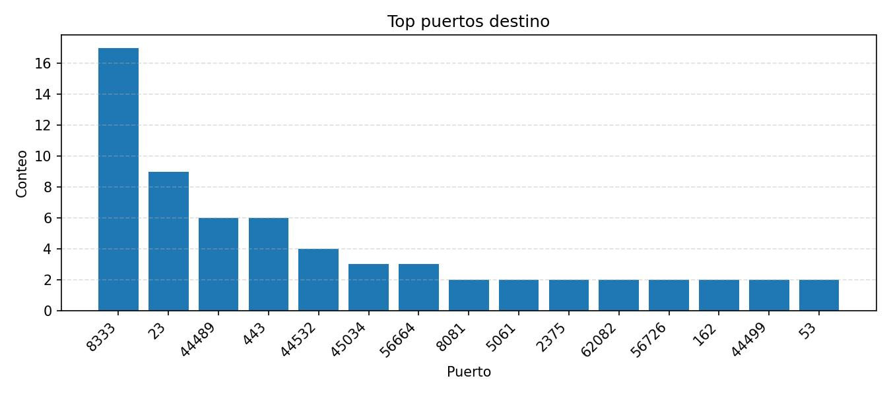
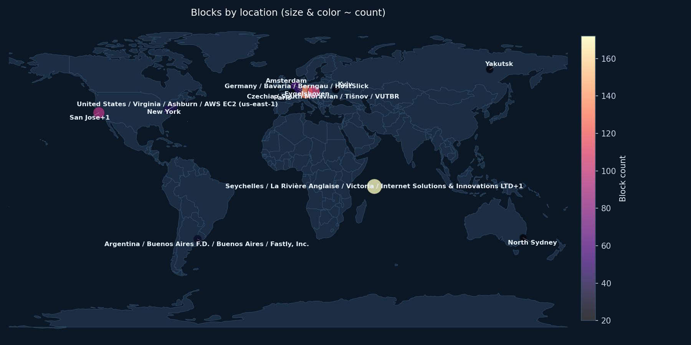

# UFW Block Report

- Log: `/var/log/ufw.log`
- Window: last 24.0 hours
- Total blocks: 4404
- Unique source IPs: 2650
- Unique countries/cities (24h): 334
- Unique destination ports: 2585

## Top destination ports
| # | Destination port | Count | % |
| ---: | --- | ---: | ---: |
| 1 | `23` | 90 | 2.0% |
| 2 | `22` | 87 | 2.0% |
| 3 | `8080` | 39 | 0.9% |
| 4 | `7680` | 38 | 0.9% |
| 5 | `3389` | 35 | 0.8% |
| 6 | `1433` | 31 | 0.7% |
| 7 | `8443` | 30 | 0.7% |
| 8 | `53` | 28 | 0.6% |
| 9 | `5060` | 27 | 0.6% |
| 10 | `8081` | 22 | 0.5% |
| 11 | `123` | 19 | 0.4% |
| 12 | `8000` | 19 | 0.4% |
| 13 | `21` | 19 | 0.4% |
| 14 | `3306` | 18 | 0.4% |
| 15 | `1194` | 17 | 0.4% |

## Top protocols
| # | Protocol | Count | % |
| ---: | --- | ---: | ---: |
| 1 | `TCP` | 3932 | 89.3% |
| 2 | `UDP` | 467 | 10.6% |
| 3 | `47` | 3 | 0.1% |
| 4 | `4` | 1 | 0.0% |
| 5 | `132` | 1 | 0.0% |

## Top source IPs
| # | Source IP | Count | % |
| ---: | --- | ---: | ---: |
| 1 | `72.203.72.165` | 18 | 0.4% |
| 2 | `151.101.218.13` | 17 | 0.4% |
| 3 | `45.198.224.125` | 16 | 0.4% |
| 4 | `193.122.235.59` | 16 | 0.4% |
| 5 | `129.80.221.208` | 15 | 0.3% |
| 6 | `195.184.76.180` | 14 | 0.3% |
| 7 | `91.231.89.224` | 14 | 0.3% |
| 8 | `91.231.89.10` | 13 | 0.3% |
| 9 | `195.184.76.198` | 13 | 0.3% |
| 10 | `195.184.76.49` | 13 | 0.3% |
| 11 | `193.122.214.162` | 13 | 0.3% |
| 12 | `2.22.149.162` | 13 | 0.3% |
| 13 | `18.221.179.104` | 12 | 0.3% |
| 14 | `91.196.152.190` | 12 | 0.3% |
| 15 | `195.184.76.62` | 12 | 0.3% |

## Top TCP flag patterns
| # | Flags | Count | % |
| ---: | --- | ---: | ---: |
| 1 | `SYN` | 3815 | 97.0% |
| 2 | `ACK+FIN+PSH` | 78 | 2.0% |
| 3 | `ACK+PSH` | 28 | 0.7% |
| 4 | `SYN+ECE+CWR` | 6 | 0.2% |
| 5 | `ACK+FIN` | 5 | 0.1% |

## Top inbound interfaces (IN)
| # | Interface | Count | % |
| ---: | --- | ---: | ---: |
| 1 | `eth0` | 4404 | 100.0% |

## Top source IP -> destination port
| # | Source IP -> port | Count | % |
| ---: | --- | ---: | ---: |
| 1 | `72.203.72.165` -> `7680` | 18 | 0.4% |
| 2 | `73.69.184.58` -> `7680` | 10 | 0.2% |
| 3 | `104.238.118.239` -> `23` | 8 | 0.2% |
| 4 | `151.101.218.13` -> `35477` | 8 | 0.2% |
| 5 | `85.234.131.81` -> `23` | 7 | 0.2% |
| 6 | `118.212.132.226` -> `22` | 6 | 0.1% |
| 7 | `183.111.206.34` -> `3389` | 6 | 0.1% |
| 8 | `129.222.241.120` -> `7680` | 5 | 0.1% |
| 9 | `151.101.218.73` -> `33781` | 5 | 0.1% |
| 10 | `81.171.6.91` -> `22` | 5 | 0.1% |
| 11 | `151.101.218.73` -> `53950` | 5 | 0.1% |
| 12 | `66.132.159.89` -> `8443` | 5 | 0.1% |
| 13 | `2.22.149.177` -> `56112` | 5 | 0.1% |
| 14 | `2.22.149.145` -> `36149` | 5 | 0.1% |
| 15 | `35.214.138.58` -> `44443` | 4 | 0.1% |

## Blocks per hour (UTC)
| Hour (UTC) | Count | % |
| :--- | ---: | ---: |
| 2026-11-20 04:00:00:00 | 136 | 3.1% |
| 2026-11-20 05:00:00:00 | 180 | 4.1% |
| 2026-11-20 06:00:00:00 | 180 | 4.1% |
| 2026-11-20 07:00:00:00 | 180 | 4.1% |
| 2026-11-20 08:00:00:00 | 180 | 4.1% |
| 2026-11-20 09:00:00:00 | 179 | 4.1% |
| 2026-11-20 10:00:00:00 | 181 | 4.1% |
| 2026-11-20 11:00:00:00 | 179 | 4.1% |
| 2026-11-20 12:00:00:00 | 180 | 4.1% |
| 2026-11-20 13:00:00:00 | 181 | 4.1% |
| 2026-11-20 14:00:00:00 | 178 | 4.0% |
| 2026-11-20 15:00:00:00 | 200 | 4.5% |
| 2026-11-20 16:00:00:00 | 179 | 4.1% |
| 2026-11-20 17:00:00:00 | 179 | 4.1% |
| 2026-11-20 18:00:00:00 | 183 | 4.2% |
| 2026-11-20 19:00:00:00 | 179 | 4.1% |
| 2026-11-20 20:00:00:00 | 180 | 4.1% |
| 2026-11-20 21:00:00:00 | 181 | 4.1% |
| 2026-11-20 22:00:00:00 | 190 | 4.3% |
| 2026-11-20 23:00:00:00 | 179 | 4.1% |
| 2026-11-21 00:00:00:00 | 194 | 4.4% |
| 2026-11-21 01:00:00:00 | 198 | 4.5% |
| 2026-11-21 02:00:00:00 | 192 | 4.4% |
| 2026-11-21 03:00:00:00 | 191 | 4.3% |
| 2026-11-21 04:00:00:00 | 45 | 1.0% |

## Top source countries/cities
| # | Location | Count | % |
| ---: | --- | ---: | ---: |
| 1 | Warrenton, United States | 52 | 24.6% |
| 2 | Ashburn, United States | 44 | 20.9% |
| 3 | Buenos Aires, Argentina | 30 | 14.2% |
| 4 | Gravelines, France | 27 | 12.8% |
| 5 | San Clemente, United States | 18 | 8.5% |
| 6 | Stockholm, Sweden | 16 | 7.6% |
| 7 | Dublin, United States | 12 | 5.7% |
| 8 | Roubaix, France | 12 | 5.7% |

## Geolocation (max 15 IPs)
| # | Source IP | Count | % | Location | Network / hint |
| ---: | --- | ---: | ---: | --- | --- |
| 1 | `72.203.72.165` | 18 | 8.5% | United States / California / San Clemente / Cox Communications Inc. | No apparent signal |
| 2 | `151.101.218.13` | 17 | 8.1% | Argentina / Buenos Aires F.D. / Buenos Aires / Fastly, Inc. | CDN/Edge (fastly) |
| 3 | `45.198.224.125` | 16 | 7.6% | Sweden / Stockholm County / Stockholm / Vpsvault.host LTD | No apparent signal |
| 4 | `193.122.235.59` | 16 | 7.6% | United States / Virginia / Ashburn / Oracle Cloud Infrastructure (us-ashburn-1) | No apparent signal |
| 5 | `129.80.221.208` | 15 | 7.1% | United States / Virginia / Ashburn / Oracle Cloud Infrastructure (us-ashburn-1) | No apparent signal |
| 6 | `195.184.76.180` | 14 | 6.6% | United States / Virginia / Warrenton / ONYPHE | No apparent signal |
| 7 | `91.231.89.224` | 14 | 6.6% | France / Hauts-de-France / Gravelines / ONYPHE | No apparent signal |
| 8 | `91.231.89.10` | 13 | 6.2% | France / Hauts-de-France / Gravelines / ONYPHE | No apparent signal |
| 9 | `195.184.76.198` | 13 | 6.2% | United States / Virginia / Warrenton / ONYPHE | No apparent signal |
| 10 | `195.184.76.49` | 13 | 6.2% | United States / Virginia / Warrenton / ONYPHE | No apparent signal |
| 11 | `193.122.214.162` | 13 | 6.2% | United States / Virginia / Ashburn / Oracle Cloud Infrastructure (us-ashburn-1) | No apparent signal |
| 12 | `2.22.149.162` | 13 | 6.2% | Argentina / Buenos Aires F.D. / Buenos Aires / Akamai Technologies | CDN/Edge (akamai) |
| 13 | `18.221.179.104` | 12 | 5.7% | United States / Ohio / Dublin / AWS EC2 (us-east-2) | Hosting/Cloud (aws) |
| 14 | `91.196.152.190` | 12 | 5.7% | France / Hauts-de-France / Roubaix / ONYPHE | No apparent signal |
| 15 | `195.184.76.62` | 12 | 5.7% | United States / Virginia / Warrenton / ONYPHE | No apparent signal |

## VPN/Proxy/Hosting suspicion (heuristic)
| # | Source IP | Count | % | Suspicion | Location |
| ---: | --- | ---: | ---: | --- | --- |
| 1 | `151.101.218.13` | 17 | 40.5% | CDN/Edge (fastly) | Argentina / Buenos Aires F.D. / Buenos Aires / Fastly, Inc. |
| 2 | `2.22.149.162` | 13 | 31.0% | CDN/Edge (akamai) | Argentina / Buenos Aires F.D. / Buenos Aires / Akamai Technologies |
| 3 | `18.221.179.104` | 12 | 28.6% | Hosting/Cloud (aws) | United States / Ohio / Dublin / AWS EC2 (us-east-2) |

## Charts

