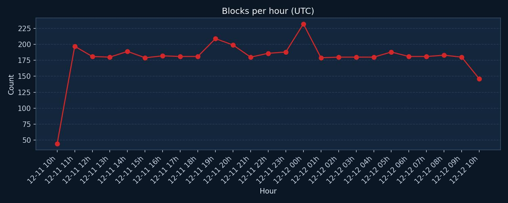

# UFW Block Report

- Log: `/var/log/ufw.log`
- Window: last 24.0 hours
- Total blocks: 4396
- Unique source IPs: 2598
- Unique countries/cities (24h): 286
- Unique destination ports: 2513

## Top destination ports
| # | Destination port | Count | % |
| ---: | --- | ---: | ---: |
| 1 | `23` | 123 | 2.8% |
| 2 | `22` | 71 | 1.6% |
| 3 | `8080` | 40 | 0.9% |
| 4 | `1194` | 39 | 0.9% |
| 5 | `3389` | 37 | 0.8% |
| 6 | `53` | 35 | 0.8% |
| 7 | `5060` | 34 | 0.8% |
| 8 | `1433` | 28 | 0.6% |
| 9 | `161` | 25 | 0.6% |
| 10 | `8081` | 24 | 0.5% |
| 11 | `3306` | 19 | 0.4% |
| 12 | `8443` | 18 | 0.4% |
| 13 | `123` | 18 | 0.4% |
| 14 | `1723` | 16 | 0.4% |
| 15 | `8888` | 16 | 0.4% |

## Top protocols
| # | Protocol | Count | % |
| ---: | --- | ---: | ---: |
| 1 | `TCP` | 4011 | 91.2% |
| 2 | `UDP` | 378 | 8.6% |
| 3 | `47` | 6 | 0.1% |
| 4 | `4` | 1 | 0.0% |

## Top source IPs
| # | Source IP | Count | % |
| ---: | --- | ---: | ---: |
| 1 | `85.93.13.34` | 34 | 0.8% |
| 2 | `57.128.238.13` | 20 | 0.5% |
| 3 | `182.253.205.236` | 18 | 0.4% |
| 4 | `195.184.76.220` | 16 | 0.4% |
| 5 | `79.124.62.10` | 16 | 0.4% |
| 6 | `91.230.168.190` | 14 | 0.3% |
| 7 | `18.221.179.104` | 14 | 0.3% |
| 8 | `45.198.224.125` | 13 | 0.3% |
| 9 | `149.154.166.110` | 13 | 0.3% |
| 10 | `18.217.208.51` | 12 | 0.3% |
| 11 | `18.119.209.50` | 12 | 0.3% |
| 12 | `91.231.89.215` | 12 | 0.3% |
| 13 | `195.184.76.175` | 12 | 0.3% |
| 14 | `195.184.76.198` | 12 | 0.3% |
| 15 | `192.207.105.196` | 12 | 0.3% |

## Top TCP flag patterns
| # | Flags | Count | % |
| ---: | --- | ---: | ---: |
| 1 | `SYN` | 3911 | 97.5% |
| 2 | `ACK+FIN+PSH` | 64 | 1.6% |
| 3 | `ACK+PSH` | 20 | 0.5% |
| 4 | `ACK+FIN` | 12 | 0.3% |
| 5 | `SYN+ECE+CWR` | 4 | 0.1% |

## Top inbound interfaces (IN)
| # | Interface | Count | % |
| ---: | --- | ---: | ---: |
| 1 | `eth0` | 4396 | 100.0% |

## Top source IP -> destination port
| # | Source IP -> port | Count | % |
| ---: | --- | ---: | ---: |
| 1 | `57.128.238.13` -> `1194` | 20 | 0.5% |
| 2 | `182.253.205.236` -> `23` | 18 | 0.4% |
| 3 | `51.77.50.68` -> `1194` | 9 | 0.2% |
| 4 | `45.198.224.125` -> `8081` | 6 | 0.1% |
| 5 | `216.180.246.16` -> `53` | 6 | 0.1% |
| 6 | `95.100.88.82` -> `61918` | 6 | 0.1% |
| 7 | `170.51.247.32` -> `19427` | 6 | 0.1% |
| 8 | `170.64.224.25` -> `23` | 6 | 0.1% |
| 9 | `169.150.214.131` -> `20765` | 6 | 0.1% |
| 10 | `170.51.247.41` -> `20785` | 6 | 0.1% |
| 11 | `178.20.210.152` -> `1723` | 5 | 0.1% |
| 12 | `118.212.132.226` -> `22` | 5 | 0.1% |
| 13 | `221.146.115.141` -> `23` | 5 | 0.1% |
| 14 | `147.93.176.170` -> `5060` | 4 | 0.1% |
| 15 | `196.244.192.202` -> `22` | 4 | 0.1% |

## Blocks per hour (UTC)
| Hour (UTC) | Count | % |
| :--- | ---: | ---: |
| 2026-11-16 04:00:00:00 | 135 | 3.1% |
| 2026-11-16 05:00:00:00 | 180 | 4.1% |
| 2026-11-16 06:00:00:00 | 180 | 4.1% |
| 2026-11-16 07:00:00:00 | 177 | 4.0% |
| 2026-11-16 08:00:00:00 | 182 | 4.1% |
| 2026-11-16 09:00:00:00 | 180 | 4.1% |
| 2026-11-16 10:00:00:00 | 180 | 4.1% |
| 2026-11-16 11:00:00:00 | 179 | 4.1% |
| 2026-11-16 12:00:00:00 | 182 | 4.1% |
| 2026-11-16 13:00:00:00 | 179 | 4.1% |
| 2026-11-16 14:00:00:00 | 181 | 4.1% |
| 2026-11-16 15:00:00:00 | 179 | 4.1% |
| 2026-11-16 16:00:00:00 | 181 | 4.1% |
| 2026-11-16 17:00:00:00 | 177 | 4.0% |
| 2026-11-16 18:00:00:00 | 181 | 4.1% |
| 2026-11-16 19:00:00:00 | 181 | 4.1% |
| 2026-11-16 20:00:00:00 | 181 | 4.1% |
| 2026-11-16 21:00:00:00 | 211 | 4.8% |
| 2026-11-16 22:00:00:00 | 181 | 4.1% |
| 2026-11-16 23:00:00:00 | 196 | 4.5% |
| 2026-11-17 00:00:00:00 | 181 | 4.1% |
| 2026-11-17 01:00:00:00 | 180 | 4.1% |
| 2026-11-17 02:00:00:00 | 181 | 4.1% |
| 2026-11-17 03:00:00:00 | 206 | 4.7% |
| 2026-11-17 04:00:00:00 | 45 | 1.0% |

## Top source countries/cities
| # | Location | Count | % |
| ---: | --- | ---: | ---: |
| 1 | Warrenton, United States | 40 | 17.4% |
| 2 | Dublin, United States | 38 | 16.5% |
| 3 | Bad Soden am Taunus, Germany | 34 | 14.8% |
| 4 | Warsaw, Poland | 20 | 8.7% |
| 5 | Depok, Indonesia | 18 | 7.8% |
| 6 | Victoria, Seychelles | 16 | 7.0% |
| 7 | Hillsboro, United States | 14 | 6.1% |
| 8 | Stockholm, Sweden | 13 | 5.7% |
| 9 | Amsterdam, Netherlands | 13 | 5.7% |
| 10 | Gravelines, France | 12 | 5.2% |
| 11 | Newburyport, United States | 12 | 5.2% |

## Geolocation (max 15 IPs)
| # | Source IP | Count | % | Location | Network / hint |
| ---: | --- | ---: | ---: | --- | --- |
| 1 | `85.93.13.34` | 34 | 14.8% | Germany / Hesse / Bad Soden am Taunus / GHOSTnet GmbH | No apparent signal |
| 2 | `57.128.238.13` | 20 | 8.7% | Poland / Mazovia / Warsaw / OVH Sp. z o. o | Hosting/Cloud (ovh) |
| 3 | `182.253.205.236` | 18 | 7.8% | Indonesia / West Java / Depok / BIZNET | No apparent signal |
| 4 | `195.184.76.220` | 16 | 7.0% | United States / Virginia / Warrenton / ONYPHE | No apparent signal |
| 5 | `79.124.62.10` | 16 | 7.0% | Seychelles / La Rivière Anglaise / Victoria / Internet Solutions & Innovations LTD | No apparent signal |
| 6 | `91.230.168.190` | 14 | 6.1% | United States / Oregon / Hillsboro / ONYPHE | No apparent signal |
| 7 | `18.221.179.104` | 14 | 6.1% | United States / Ohio / Dublin / AWS EC2 (us-east-2) | Hosting/Cloud (aws) |
| 8 | `45.198.224.125` | 13 | 5.7% | Sweden / Stockholm County / Stockholm / Vpsvault.host LTD | No apparent signal |
| 9 | `149.154.166.110` | 13 | 5.7% | Netherlands / North Holland / Amsterdam / Telegram Messenger Amsterdam Network | No apparent signal |
| 10 | `18.217.208.51` | 12 | 5.2% | United States / Ohio / Dublin / AWS EC2 (us-east-2) | Hosting/Cloud (aws) |
| 11 | `18.119.209.50` | 12 | 5.2% | United States / Ohio / Dublin / AWS EC2 (us-east-2) | Hosting/Cloud (aws) |
| 12 | `91.231.89.215` | 12 | 5.2% | France / Hauts-de-France / Gravelines / ONYPHE | No apparent signal |
| 13 | `195.184.76.175` | 12 | 5.2% | United States / Virginia / Warrenton / ONYPHE | No apparent signal |
| 14 | `195.184.76.198` | 12 | 5.2% | United States / Virginia / Warrenton / ONYPHE | No apparent signal |
| 15 | `192.207.105.196` | 12 | 5.2% | United States / Massachusetts / Newburyport / Searchlight Cyber LLC | Hosting/Cloud (ovh) |

## VPN/Proxy/Hosting suspicion (heuristic)
| # | Source IP | Count | % | Suspicion | Location |
| ---: | --- | ---: | ---: | --- | --- |
| 1 | `57.128.238.13` | 20 | 28.6% | Hosting/Cloud (ovh) | Poland / Mazovia / Warsaw / OVH Sp. z o. o |
| 2 | `18.221.179.104` | 14 | 20.0% | Hosting/Cloud (aws) | United States / Ohio / Dublin / AWS EC2 (us-east-2) |
| 3 | `18.217.208.51` | 12 | 17.1% | Hosting/Cloud (aws) | United States / Ohio / Dublin / AWS EC2 (us-east-2) |
| 4 | `18.119.209.50` | 12 | 17.1% | Hosting/Cloud (aws) | United States / Ohio / Dublin / AWS EC2 (us-east-2) |
| 5 | `192.207.105.196` | 12 | 17.1% | Hosting/Cloud (ovh) | United States / Massachusetts / Newburyport / Searchlight Cyber LLC |

## Charts

